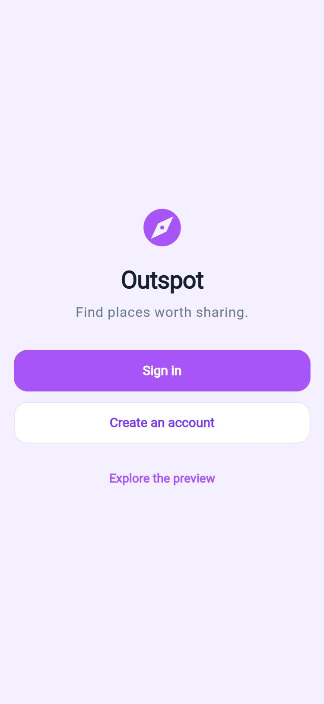
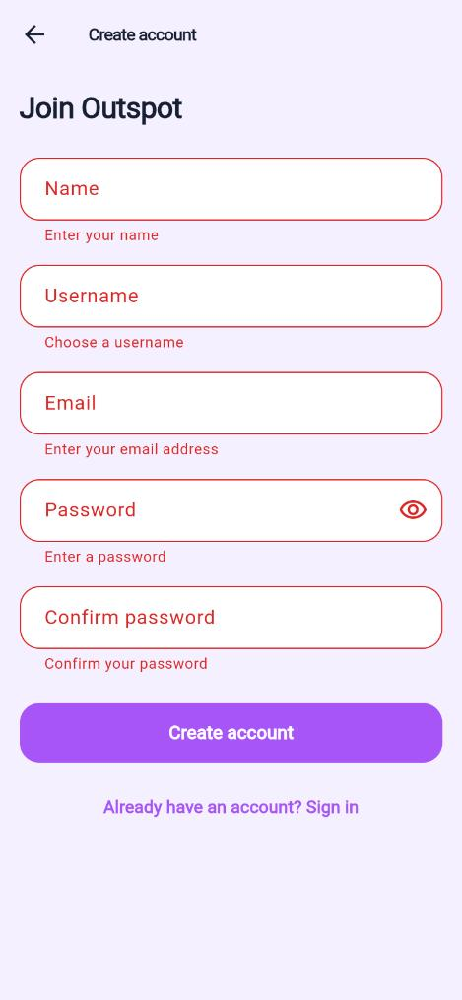
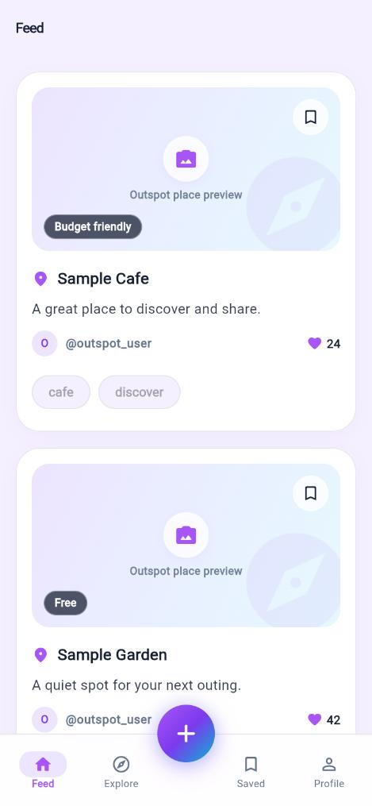
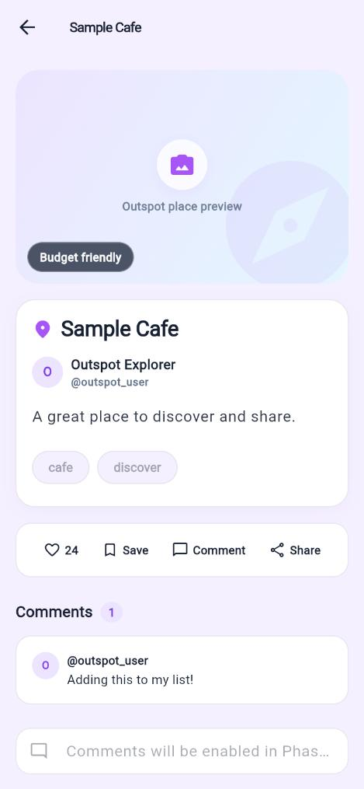
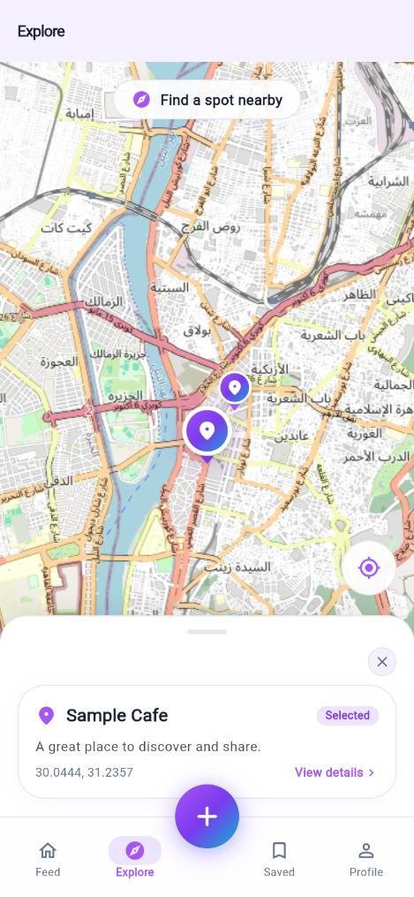
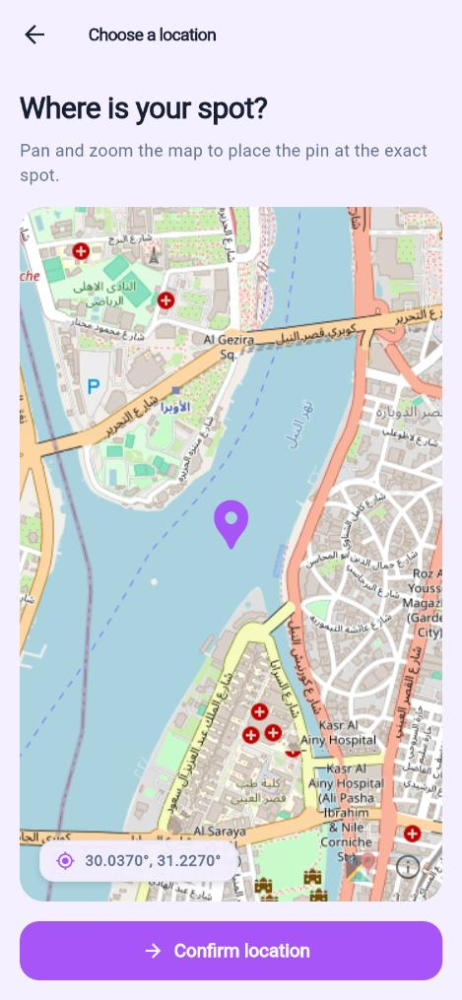
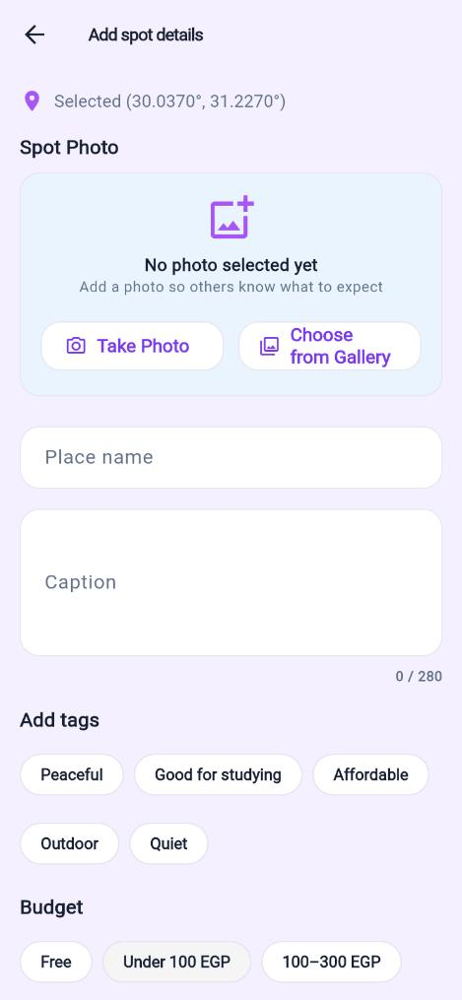
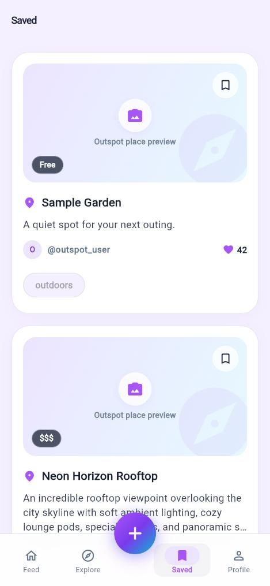
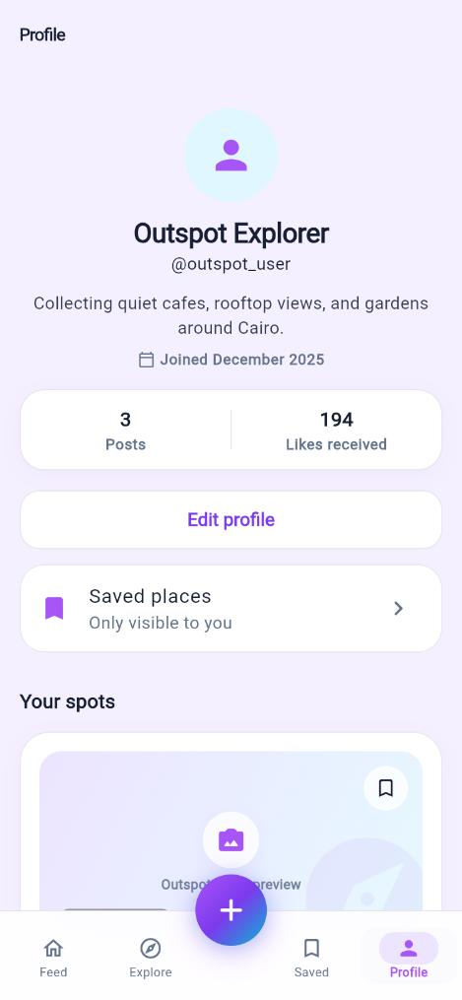
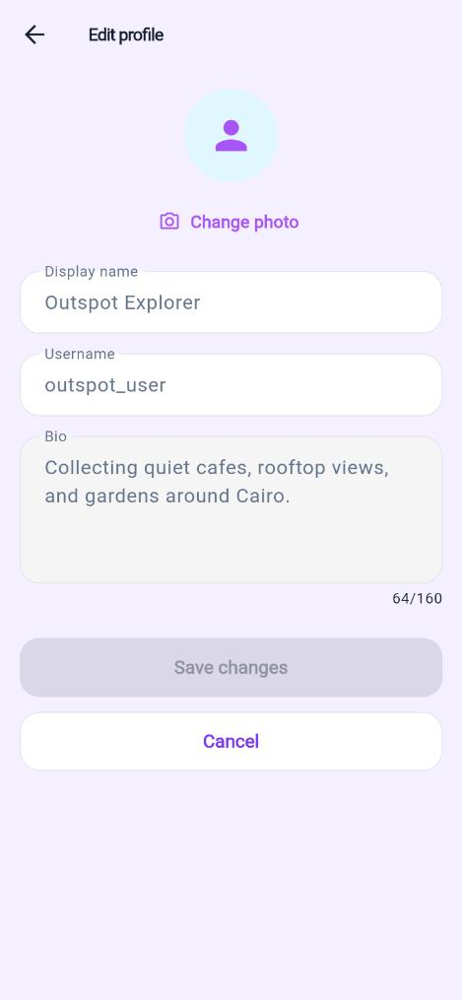

# Outspot

Outspot is a Flutter mobile application for discovering and sharing places.

## Requirements

- Flutter SDK
- Android Studio
- Android SDK and an Android emulator or compatible Android device

## Supported Platforms

- Android

## Android Package Identifier

See the `applicationId` in `android/app/build.gradle` or `android/app/build.gradle.kts`.

## Setup

From the repository root:

```bash
flutter pub get
```

## Run

Start an Android emulator or connect an Android device:

```bash
flutter run
```

To target a specific connected device:

```bash
flutter devices
flutter run -d <device-id>
```

## Project Structure

- `lib/main.dart` — application entry point and shared dependency setup.
- `lib/features/navigation/` — persistent main navigation shell.
- `lib/app/outspot_app.dart` — the single `MaterialApp` shell and app-wide theme.
- `lib/core/navigation/app_routes.dart` — central route-name and route-title registry.
- `lib/core/navigation/app_router.dart` — the only named-route factory.
- `lib/core/theme/` — shared color, typography, and spacing tokens.
- `lib/core/widgets/` — reusable buttons, form fields, tags, cards, loading, empty, and error states.
- `lib/models/` — shared `Spot`, `Profile`, and `Comment` models.
- `lib/data/repositories/` — repository contract, mock implementation, and shared spot provider.
- `lib/data/fixtures/` — local sample data used during development and testing.
- `lib/features/auth/` — authentication screens and shared `AuthValidators`.
- `lib/features/feed/` — feed screen and spot-card/list widgets.
- `lib/features/explore/` — explore screen and map-marker preview widget.
- `lib/features/create_spot/` — create-spot screen and behavior.
- `lib/features/profile/` — profile and edit-profile screens, profile view and avatar widgets.
- `lib/features/saved/` — Saved Places screen.
- `lib/features/spot_detail/` — spot-detail screen and widget.
- `lib/features/shared/` — temporary feature placeholders used while screens are built.
- `test/` — automated unit, widget, and application tests.
- `docs/` — project concept and milestone plan (`phase-1-concept.md`) and app screenshots.

`OutspotApp` is the only app shell; register named screens in `AppRoutes` and resolve them in `AppRouter`. Login and registration routes sit outside the main shell. The local preview offers entry into Feed, Explore, Create, Saved, and Profile without a backend session. Create begins at location selection and proceeds to a validated details form; the map and publish step are local UI previews.

The main shell preserves Feed, Explore, Saved, and Profile tab state while switching destinations. Its centered Create action pushes the location-first flow, so Back returns to the prior tab. Spot cards open the matching detail route.

Repository-backed screens should handle loading, empty, error, and data states with `AppLoadingIndicator`, `AppEmptyState`, and `AppErrorState`. Forms should use `AppTextField` validation and `AppSubmitButton` for disabled/submitting feedback. Feed and Saved exercise these states with the mock repository.

Shared controls live in `lib/core/widgets/`: `AppButton`, `AppTextField`, `AppTagChip`, `SpotCardShell`, page padding, and common state widgets. `AppTheme` and `AppSpacing` are the source for shared type, color, and spacing decisions. Feature screens live in their respective `lib/features/<feature>/screens/` folders. These are Phase 1 mock screens, not live authentication, map, image upload, or publishing behavior.

## Phase 1 Screens

| Welcome | Create account | Feed | Spot detail | Explore |
| --- | --- | --- | --- | --- |
|  |  |  |  |  |

| Choose location | Spot details | Saved | Profile | Edit profile |
| --- | --- | --- | --- | --- |
|  |  |  |  |  |

### Demo walkthrough

1. Launch the app and choose **Create an account**. Submit empty to see validation, then enter valid details to reach the feed.
2. Open a feed card to see its detail, then go back.
3. On **Explore**, tap a marker to preview the matching spot.
4. Tap **+**, confirm the pinned location, fill in the details, pick tags and a budget, and preview the spot.
5. On **Profile**, edit the display name and save, then open **Saved places**.

### Phase 1 placeholders

Everything runs on local mock data; nothing is persisted between launches.

- Sign in and registration validate input, then open the feed without creating a session. The Profile tab always shows the sample user.
- Profile edits live only in memory and do not change author names on existing spots. Avatar upload shows a "Phase 2" notice.
- Like, Save, Comment, and Share buttons on the spot detail show placeholder notices; card bookmark icons are decorative. The Saved list is seeded from `sampleSavedSpotIds`.
- Photo selection, map tiles, and publishing are local previews. Publishing does not add the spot to the feed.

## Phase 2 Contract

These interfaces are frozen at the end of Phase 1. Phase 2 implements them against Supabase without changing screen code. Propose any change in the team channel first.

**Models** (`lib/models/`)

| Model | Fields |
| --- | --- |
| `Profile` | `id`, `username`, `displayName?`, `avatarUrl?`, `bio?`, `joinedAt?` |
| `Spot` | `id`, `author` (`Profile`), `caption`, `createdAt`, `placeName?`, `latitude?`, `longitude?`, `photoReference?`, `tags`, `budgetLabel?`, `likeCount?` |
| `Comment` | `id`, `spotId`, `author` (`Profile`), `text`, `createdAt` |

**Repository** (`SpotRepository`): `listSpots` (newest first), `getSpot`, `createSpot`, `editSpot`, `deleteSpot`, `likeSpot`, `unlikeSpot`, `saveSpot`, `unsaveSpot`, `listSavedSpots` (newest first), `listComments`, `addComment`. `SpotProvider` exposes the loaded feed to widgets.

**Routes** (`AppRoutes`)

| Route | Screen | Argument |
| --- | --- | --- |
| `/login` | Welcome (initial route) | — |
| `/sign-in`, `/register` | Auth form | — |
| `/`, `/explore`, `/saved`, `/profile` | Main shell on that tab | — |
| `/create` → `/create/details` → `/create/review` | Create-a-spot flow | `CreateSpotReviewArgs` for review |
| `/spot-detail` | Spot detail | `Spot` |
| `/profile/edit` | Edit profile; pops the updated `Profile` | `Profile` |

**Owner boundaries:** unchanged; see the workstream table below.

## Architecture and Integration Rules

- Register application route names in `lib/core/navigation/app_routes.dart` and resolve them only in `lib/core/navigation/app_router.dart`.
- Keep app-wide dependency setup in `lib/main.dart`, the single app shell in `lib/app/outspot_app.dart`, and feature-specific UI and behavior inside the relevant feature folder.
- Use the shared models in `lib/models/`. Do not define competing feature-specific versions of `Spot`, `Profile`, or `Comment`.
- Features should access spot data through `SpotRepository` and its shared provider rather than implementing their own data access.
- `MockSpotRepository` and local fixtures support development. A future Supabase-backed implementation should implement the same repository contract so UI widgets do not depend on the storage implementation.
- Announce planned changes to `pubspec.yaml`, app startup, global routes, shared models, or shared theme in the team channel before editing those shared files. The integration coordinator owns these shared integration points.
- Keep pull requests focused, identify the related issue, describe shared files changed, and include test evidence. Before a UI PR is reviewed, its owner, shared files changed, and test evidence must be visible in the PR.

### Default workstream ownership and handoff

Each workstream has one default owner at a time. The team maps the contributor slots to names on the project board before parallel feature work starts; a PR author is responsible for recording the actual owner and handoff there.

| Workstream | Default owner | Scope and integration point |
| --- | --- | --- |
| Feed and profile | Contributor A | `lib/features/feed/`, `lib/features/profile/`; consume shared models and `SpotRepository`. |
| Explore and spot detail | Contributor B | `lib/features/explore/`, `lib/features/spot_detail/`; consume shared models and `SpotRepository`. |
| Create spot and auth | Contributor C | `lib/features/create_spot/`, `lib/features/auth/`; use shared models and repository contracts. |
| App integration | Integration coordinator | `lib/main.dart`, `lib/app/`, `lib/core/navigation/`, `lib/core/theme/`, `lib/models/`, `lib/data/repositories/`, and `pubspec.yaml`. Announce changes to shared files before editing. |

For handoff, the current owner opens a focused PR with the related task, changed shared files, route/repository integration points, and test evidence. The next owner takes over after review and records the new owner on the project board. Avoid concurrent edits to the integration coordinator's shared files; coordinate those changes in the team channel first.

## Quality Checks

Run before opening a pull request:

```bash
dart format --output=none --set-exit-if-changed lib test
flutter analyze
flutter test
```
